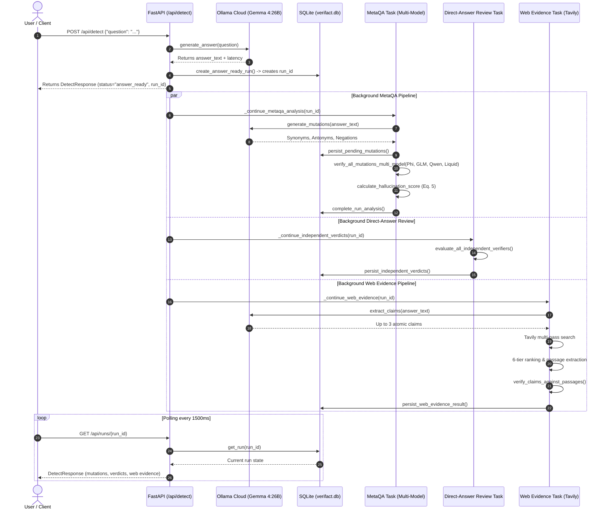
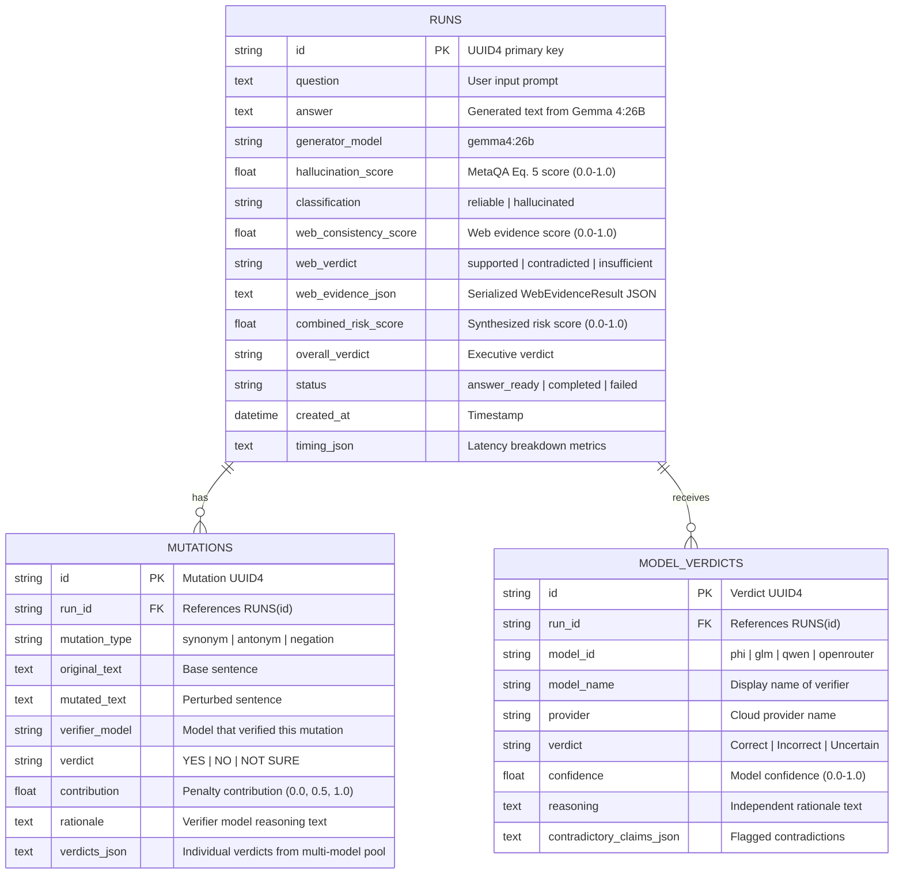

# VeriFact — System Architecture & Technical Specification

**Document Version**: 1.0.0 (Release Freeze)
**Implementation Baseline**: FastAPI Backend (`backend/`) · React 19 Frontend (`frontend/`) · SQLite (`db/verifact.db`)

---

## 1. System Overview & Technology Stack

VeriFact is architected as a decoupled, asynchronous client-server application designed for high-concurrency evaluation of generative AI answers. The architecture enforces strict modular separation between answer generation, metamorphic mutation verification, direct-answer peer review, external web factual grounding, and persistent storage.

```
┌────────────────────────────────────────────────────────────────────────┐
│                        VERIFACT SYSTEM TOPOLOGY                        │
├────────────────────────────────────────────────────────────────────────┤
│                                                                        │
│   ┌─────────────────────┐                 ┌────────────────────────┐   │
│   │   Browser Client    │                 │   FastAPI Core Server  │   │
│   │   React 19 + Vite   │◄──HTTP Polling─►│   Python 3.12 + Async  │   │
│   │   Tailwind CSS v4   │  REST JSON /api │   Uvicorn (Port 8000)  │   │
│   └─────────────────────┘                 └───────────┬────────────┘   │
│                                                       │                │
│                         ┌─────────────────────────────┼────────────┐   │
│                         │                             │            │   │
│                         ▼                             ▼            ▼   │
│              ┌────────────────────┐          ┌──────────────┐┌─────────┐
│              │ SQLite Database    │          │ Cloud LLMs   ││ Tavily  │
│              │ db/verifact.db     │          │ Multi-Pool   ││ Search  │
│              │ (Runs, Mutations)  │          │ (5 Models)   ││ API     │
│              └────────────────────┘          └──────────────┘└─────────┘
└────────────────────────────────────────────────────────────────────────┘
```

### Core Technology Stack

| Layer | Component | Version / Technology | Key Responsibilities |
|---|---|---|---|
| **Frontend** | Single-Page Application (SPA) | React 19, TypeScript 5.7, Vite 8.2 | Interactive UI, state management, mathematical formula rendering, theme styling, and run polling. |
| **Styling** | Utility CSS & Design System | Tailwind CSS v4, Lucide React | Curated desaturated palette, dark/light theme switching, responsive grid layouts. |
| **Backend** | REST API Server | Python 3.12, FastAPI 0.115, Uvicorn | Request validation, concurrency orchestration, background task dispatch, scoring formulas. |
| **Data Access** | Relational ORM | SQLAlchemy 2.0, SQLite 3 | Atomic persistence of runs, mutation records, model verdicts, and evaluation sweeps. |
| **Generation** | Answer Model Provider | Ollama Cloud (`gemma4:26b`) | Initial question answering and semantic mutation generation (synonyms, antonyms, negations). |
| **Verification** | Cross-Model Verifier Pool | OpenRouter, Cloudflare Workers AI, Groq | Multi-model evaluation of metamorphic variants and direct-answer peer review. |
| **Grounding** | Search & Extraction Engine | Tavily Search API (`tavily-python`) | Multi-pass keyword search, 6-tier domain authority ranking, passage extraction. |

---

## 2. End-to-End System Architecture

The following Mermaid diagram visualizes the complete interaction flow between the client, the FastAPI backend, external cloud model APIs, the Tavily search service, and the SQLite persistence layer:

```mermaid
flowchart TD
    subgraph Client ["Frontend (React 19 + TypeScript)"]
        UI_Home[Detect Page: Input & Accordions]
        UI_Polling[Active Run Poller /api/runs/:id]
        UI_Display[Results View: Verdicts, Scores, Sources]
        UI_Pages[MetaQA, Web Analysis, History, Settings Pages]
    end

    subgraph Server ["FastAPI Backend (app/)"]
        Router_Detect["/api/detect (routes_detect.py)"]
        Router_Runs["/api/runs (routes_runs.py)"]
        Router_Health["/api/health & /api/settings"]
        RunService["Run Service (run_service.py)"]

        subgraph Orchestration ["Asynchronous Concurrent Execution"]
            AnswerGen["1. Answer Generation (detector.py)"]
            Task_MetaQA["2. _continue_metaqa_analysis"]
            Task_Independent["3. _continue_independent_verdicts"]
            Task_WebEvidence["4. _continue_web_evidence"]
        end
    end

    subgraph Providers ["Model Registry & Cloud APIs"]
        OllamaCloud["Ollama Cloud: Gemma 4:26B\n(Answer Generator)"]
        OpenRouter_Phi["OpenRouter: Phi-4 Reasoning\n(Cross-Model Verifier)"]
        Cloudflare_GLM["Cloudflare Workers AI: GLM-4.7-Flash\n(Cross-Model Verifier)"]
        Groq_Qwen["Groq: Qwen-2.5-32B\n(Cross-Model Verifier)"]
        OpenRouter_Liquid["OpenRouter: Liquid LFM-2.5\n(Cross-Model Verifier)"]
        TavilyAPI["Tavily Search API\n(Web Retrieval Engine)"]
    end

    subgraph Storage ["Local Storage"]
        DB[(SQLite: db/verifact.db)]
    end

    %% Client to Server
    UI_Home -->|POST /api/detect| Router_Detect
    UI_Polling -->|GET /api/runs/:id| Router_Runs
    UI_Pages -->|GET /api/health, /settings, /runs| Server

    %% Detection lifecycle
    Router_Detect --> RunService
    RunService -->|Generate Answer| AnswerGen
    AnswerGen -->|API Request| OllamaCloud
    OllamaCloud -->|Answer text| AnswerGen
    AnswerGen -->|Create Run Record| DB

    %% Background tasks spawn
    Router_Detect -.->|Spawn Background Task| Task_MetaQA
    Router_Detect -.->|Spawn Background Task| Task_Independent
    Router_Detect -.->|Spawn Background Task| Task_WebEvidence

    %% MetaQA flow
    Task_MetaQA -->|Generate Mutations| OllamaCloud
    Task_MetaQA -->|Verify Variants Concurrently| OpenRouter_Phi & Cloudflare_GLM & Groq_Qwen & OpenRouter_Liquid
    Task_MetaQA -->|Calculate Eq. 5 Score| DB

    %% Independent Direct Review flow
    Task_Independent -->|Direct Cross-Model Review| OpenRouter_Phi & Cloudflare_GLM & Groq_Qwen & OpenRouter_Liquid
    Task_Independent -->|Persist Verdicts & Contradictions| DB

    %% Web Evidence flow
    Task_WebEvidence -->|Extract Claims| OllamaCloud
    Task_WebEvidence -->|Multi-pass Search| TavilyAPI
    Task_WebEvidence -->|Tier & Assess Claims| DB

    %% Polling and resolution
    Router_Runs -->|Read Updated Run| DB
    DB -->|Complete DetectResponse JSON| UI_Polling
    UI_Polling --> UI_Display
```



---

## 3. Frontend Architecture & Component Hierarchy

The frontend is organized in `frontend/src/` with strict domain boundaries:

```
frontend/src/
├── components/
│   ├── detect/                # Detection page components
│   │   ├── AnalysisProgress.tsx       # Multi-step live progress indicators
│   │   ├── AnalysisSummary.tsx        # Executive summary and verdict pill
│   │   ├── AnswerCard.tsx             # Gemma answer card with latency
│   │   ├── AnswerModelSelector.tsx    # Model selector with cloud readiness
│   │   ├── CollapsibleModelVerdicts.tsx # Model verification explanations & verdicts
│   │   ├── IndependentVerdictsCard.tsx# Multi-model direct peer-review panel
│   │   ├── MethodOverview.tsx         # 4-step explanation & educational accordions
│   │   ├── MutationRow.tsx            # Individual metamorphic mutation display
│   │   ├── MutationTabs.tsx           # Synonym vs Antonym/Negation filtering
│   │   ├── QuestionInput.tsx          # Textarea with validation & submit triggers
│   │   ├── ScoreCard.tsx              # Component score metric tiles
│   │   ├── ScoreGauge.tsx             # SVG score gauge with threshold indicator
│   │   ├── VerificationSummaryPanel.tsx # High-level consensus synthesis
│   │   └── WebEvidencePanel.tsx       # Claims breakdown, source cards, tier pills
│   ├── layout/                # Global layout wrappers
│   │   ├── Header.tsx                 # Navigation bar, brand logo, theme switcher
│   │   ├── Footer.tsx                 # Citation links, version label, copyright
│   │   ├── Layout.tsx                 # Main layout shell with container constraints
│   │   └── ScrollToTop.tsx            # Route change scroll reset handler
│   └── ui/                    # Base primitives
│       ├── PageHeader.tsx             # Page title and subtitle component
│       └── Status.tsx                 # ErrorState, LoadingState, EmptyState primitives
├── lib/                       # Utility helpers
│   ├── format.ts                      # Score formatting, dates, provider label mappers
│   └── theme.ts                       # Theme resolution and local storage persistence
├── pages/                     # Top-level routes
│   ├── DetectPage.tsx                 # Route `/`: Main interactive detection studio
│   ├── HistoryPage.tsx                # Route `/history`: Persisted run list & viewer
│   ├── MetaQAPage.tsx                 # Route `/metaqa`: Metamorphic testing theory & Eq. 5
│   ├── SettingsPage.tsx               # Route `/settings`: Provider status & appearance
│   └── WebAnalysisPage.tsx            # Route `/web-analysis`: 6-tier web grounding theory
├── services/                  # Backend API communications
│   └── api.ts                         # Typed fetch clients for all REST endpoints
├── theme/                     # React Context
│   └── ThemeProvider.tsx              # Dynamic light/dark/system theme context
├── types/                     # Shared TypeScript interfaces
│   └── index.ts                       # Canonical API request/response contracts
└── index.css                  # Tailwind v4 theme definitions and CSS variables
```

---

## 4. Backend Architecture & Package Boundaries

The backend resides in `backend/app/`, partitioned into specialized modules:

```
backend/app/
├── api/                       # HTTP API Routes
│   ├── deps.py                        # Dependency injection (DB, Settings, LLMClient)
│   ├── routes_detect.py               # POST /api/detect, GET /api/models
│   ├── routes_evaluations.py          # Benchmark sweep endpoints (/api/evaluations)
│   ├── routes_health.py               # System & provider health (/api/health)
│   ├── routes_runs.py                 # Run retrieval (/api/runs, /api/runs/{id})
│   └── routes_settings.py             # Public settings configuration (/api/settings)
├── config.py                  # Pydantic BaseSettings loading from environment
├── database/                  # Persistence Layer
│   ├── db.py                          # SQLAlchemy engine and SessionLocal factory
│   └── models.py                      # Run, Mutation, ModelVerdict, EvaluationItem models
├── llm/                       # Provider Registry & LLM Adapters
│   ├── base.py                        # Abstract LLMClient interface
│   ├── cloudflare.py                  # CloudflareClient (GLM-4.7-Flash)
│   ├── gemini.py                      # GeminiClient (Legacy adapter)
│   ├── mock.py                        # Deterministic MockLLMClient for testing
│   ├── providers.py                   # OllamaCloudClient, OpenRouterClient, GroqClient
│   └── registry.py                    # MODEL_REGISTRY, verifier pool builder, validation
├── metaqa/                    # Metamorphic Testing Core
│   ├── detector.py                    # run_metaqa_analysis orchestrator
│   ├── multi_verifier.py              # Multi-model mutation verification loop
│   ├── mutation.py                    # Synonym, antonym, and negation generators
│   └── scoring.py                     # Deterministic Eq. 5 penalty calculation
├── schemas/                   # Pydantic v2 Serialization Contracts
│   ├── detect.py                      # DetectRequest, DetectResponse, MutationOut, RunSummary
│   └── evaluations.py                 # EvaluationMetrics, EvaluationSweepOut
├── services/                  # Business Logic & DB Transactions
│   ├── independent_verifiers.py       # Direct-answer multi-model peer review service
│   └── run_service.py                 # Run creation, updates, and database mapping
└── web_evidence/              # External Web Grounding Pipeline
    ├── claim_extractor.py             # Atomic factual claim extraction
    ├── pipeline.py                    # Multi-pass Tavily search and passage filtering
    ├── source_tiering.py              # 6-tier domain authority categorization
    ├── types.py                       # WebClaimRecord, WebSourceRecord, EvidenceVerdict
    └── verifier.py                    # NLI/claim assessment against retrieved passages
```

---

## 5. Model Registry & Verification Roles

VeriFact enforces strict role segregation. The model that creates the answer is **never** permitted to evaluate it.

```
┌────────────────────────────────────────────────────────────────────────┐
│                        MODEL REGISTRY TOPOLOGY                         │
├────────────────────────────────────────────────────────────────────────┤
│                                                                        │
│   [GENERATOR ROLE]                                                     │
│   ┌────────────────────────────────────────────────────────────────┐   │
│   │ Gemma 4:26B (Ollama Cloud · gemma4:26b)                        │   │
│   │ Generates initial answer + Synonym, Antonym & Negation variants│   │
│   │ STRICTLY EXCLUDED FROM VERIFIER POOL                           │   │
│   └────────────────────────────────┬───────────────────────────────┘   │
│                                    │ Generates                          │
│                                    ▼ Answer & Variants                  │
│   [CROSS-MODEL VERIFIER POOL]                                          │
│   ┌────────────────────────────────────────────────────────────────┐   │
│   │ 1. Microsoft Phi-4 Reasoning (OpenRouter · microsoft/phi-4...) │   │
│   │ 2. GLM-4.7-Flash (Cloudflare Workers AI · @cf/zai-org/glm...)  │   │
│   │ 3. Qwen-2.5-32B (Groq · qwen-2.5-32b)                          │   │
│   │ 4. Liquid LFM-2.5 (OpenRouter · liquid/lfm-2.5-2.6b:free)      │   │
│   │ Concurrently evaluate mutations and conduct direct-answer review│  │
│   └────────────────────────────────────────────────────────────────┘   │
│                                                                        │
│   [EXTERNAL GROUNDING]                                                 │
│   ┌────────────────────────────────────────────────────────────────┐   │
│   │ Tavily Search API (Multi-pass keyword retrieval · 6 Tiers)     │   │
│   └────────────────────────────────────────────────────────────────┘   │
└────────────────────────────────────────────────────────────────────────┘
```

### Active Model Specifications

| Registry Key | Model Display Name | Provider | Actual Model Identifier | Role |
|---|---|---|---|---|
| `gemma` | **Gemma 4:26B** | Ollama Cloud | `gemma4:26b` | **Answer Generator**: Generates primary answers, produces metamorphic mutations, extracts atomic claims. Excluded from verifier pool. |
| `phi` | **Phi-4 Reasoning** | OpenRouter (Microsoft) | `microsoft/phi-4-reasoning:free` | **Verifier**: Metamorphic mutation reasoning, direct-answer review. |
| `glm` | **GLM-4.7-Flash** | Cloudflare Workers AI | `@cf/zai-org/glm-4.7-flash` | **Verifier**: High-speed semantic validation, direct-answer review. |
| `qwen` | **Qwen-2.5-32B** | Groq (Alibaba / Groq) | `qwen-2.5-32b` | **Verifier**: Ultra-low-latency judgment, consensus analysis. |
| `openrouter` | **Liquid LFM-2.5** | OpenRouter (Liquid AI) | `liquid/lfm-2.5-2.6b:free` | **Verifier**: Non-transformer hybrid architecture evaluation. |
| *N/A* | **Tavily Search** | Tavily | API Client | **Grounding Engine**: 2-pass search query retrieval for factual claims. |

*Note on Google Gemini*: Google Gemini is maintained as an optional legacy adapter; it is disabled by default (`gemini_verifier_ready: False`) and is not part of the active verifier pool.

---

## 6. The Complete Detection Lifecycle

When a user submits a question via `POST /api/detect`:



---

## 7. Mathematical Scoring Formulas & Semantics

### 7.1 MetaQA Hallucination Score (Equation 5)
Formulated by Yang et al. (*ACM FSE 2025*), the metamorphic inconsistency score $S$ measures whether model behavior adheres to metamorphic relations:

$$S = \frac{1}{2} \left( \frac{1}{|M_{\text{syn}}|} \sum_{m \in M_{\text{syn}}} \text{penalty}(m) + \frac{1}{|M_{\text{ant}}|} \sum_{m \in M_{\text{ant}}} \text{penalty}(m) \right)$$

Where:
- $M_{\text{syn}}$: Meaning-preserving synonym mutations. The expected response is `YES`. If the model responds `NO`, $\text{penalty} = 1.0$; if `YES`, $\text{penalty} = 0.0$; if `NOT SURE`, $\text{penalty} = 0.5$.
- $M_{\text{ant}}$: Meaning-reversing antonym and negation mutations. The expected response is `NO`. If the model responds `YES`, $\text{penalty} = 1.0$; if `NO`, $\text{penalty} = 0.0$; if `NOT SURE`, $\text{penalty} = 0.5$.
- **Boundary**: $S \in [0.0, 1.0]$.
- **Decision Cutoff**: Threshold $\theta = 0.50$:
  $$\text{Classification} = \begin{cases} \text{Likely Hallucinated}, & \text{if } S \ge 0.50 \\ \text{Likely Reliable}, & \text{if } S < 0.50 \end{cases}$$

### 7.2 Web Evidence Consistency Score
Measures external factual support across extracted claims:

$$\text{Consistency Score} = \frac{1}{|C_{\text{assessed}}|} \sum_{c \in C_{\text{assessed}}} \text{contribution}(c)$$

Where:
- $\text{contribution}(\text{SUPPORTED}) = 1.0$
- $\text{contribution}(\text{INSUFFICIENT\_EVIDENCE}) = 0.5$
- $\text{contribution}(\text{CONTRADICTED}) = 0.0$
- Claims marked `NOT_ASSESSED_NO_RELEVANT_SOURCE` are **completely excluded** from both the numerator and the denominator. If no claims were assessed, the score is `null`.

### 7.3 Combined Risk Score Synthesis
An application-level heuristic that synthesizes both orthogonal branches:

$$\text{Combined Risk} = \alpha \cdot S + (1 - \alpha) \cdot (1 - \text{Consistency Score})$$

*(Default weight $\alpha = 0.50$ when both signals are available. If Web Evidence produces no score, Combined Risk defaults to $S$.)*

> **Important Scientific Constraint**: Scores are normalized heuristic indicators of metamorphic instability and external source contradiction. They are **not** calibrated Bayesian probabilities of factual truth.

---

## 8. Web Evidence: 6-Tier Authority Hierarchy & Relevance

The Web Evidence pipeline enforces a 6-tier domain authority model:

| Tier | Name | Criteria & Domain Examples | Authority Weight |
|---|---|---|---|
| **Tier 1** | **Primary & Official** | `.gov`, `.mil`, `.edu`, official documentation, primary corporate registries | 1.00 |
| **Tier 2** | **Academic & Research** | `arxiv.org`, `nature.com`, `ieee.org`, university institutional repositories | 0.85 |
| **Tier 3** | **Reputable News & Fact-Check** | Reuters, Associated Press, BBC, FactCheck.org, Snopes, PolitiFact | 0.70 |
| **Tier 4** | **Reference & Encyclopedias** | Wikipedia, Encyclopaedia Britannica, Stanford Encyclopedia of Philosophy | 0.55 |
| **Tier 5** | **General Web** | High-traffic commercial domains, mainstream tech publications, industry blogs | 0.35 |
| **Tier 6** | **Low Priority** | Public forums (Reddit, Quora), social media, unvetted user-generated content | 0.15 |

### Relevance Cutoff & Filtering
Retrieved search snippets are scored against the claim text. Snippets scoring below **$0.20$ relevance** are discarded as off-topic to prevent irrelevant web noise from distorting verification.

---

## 9. SQLite Database Schema

The database is managed by SQLAlchemy in `backend/app/database/models.py`:



---

## 10. Configuration & Environment Variables

All settings load through Pydantic BaseSettings in `backend/app/config.py`:

| Environment Variable | Default Value | Purpose |
|---|---|---|
| `LLM_MODE` | `live` | `live` for cloud APIs, `mock` for deterministic test fixtures. |
| `OLLAMA_API_KEY` | *Empty* | Ollama Cloud credentials for Gemma 4:26B answer generation. |
| `OLLAMA_CLOUD_BASE_URL` | `https://ollama.com/api` | Ollama Cloud endpoint. |
| `OPENROUTER_API_KEY` | *Empty* | OpenRouter credentials for Microsoft Phi-4 and Liquid LFM-2.5. |
| `CLOUDFLARE_API_TOKEN` | *Empty* | Cloudflare Workers AI token for GLM-4.7-Flash. |
| `CLOUDFLARE_ACCOUNT_ID` | *Empty* | Cloudflare Account ID for Workers AI routing. |
| `GROQ_API_KEY` | *Empty* | Groq credentials for Qwen-2.5-32B ultra-fast inference. |
| `TAVILY_API_KEY` | *Empty* | Tavily Search API key for Web Evidence grounding. |
| `THRESHOLD` | `0.5` | Fixed MetaQA decision boundary ($\theta$). |
| `SYNONYM_COUNT` | `3` | Number of synonym mutations per testable sentence. |
| `ANTONYM_COUNT` | `3` | Number of antonym/negation mutations per testable sentence. |
| `WEB_MAX_CLAIMS` | `3` | Maximum atomic claims extracted from generated answer. |
| `WEB_MAX_SEARCHES` | `3` | Maximum search queries executed per claim. |
| `TAVILY_SEARCH_DEPTH` | `basic` | Tavily search depth (`basic` or `advanced`). |

---

## 11. Development Startup & Testing Commands

### Backend Startup & Tests
```bash
# Activate virtual environment (Windows PowerShell)
cd backend
.\.venv\Scripts\Activate.ps1

# Run development server
uvicorn app.main:app --host 127.0.0.1 --port 8000 --reload

# Run comprehensive test suite (491 tests)
pytest -q
```

### Frontend Startup & Tests
```bash
cd frontend

# Install dependencies
npm install

# Start Vite dev server (Port 5173)
npm run dev

# Run unit tests (Vitest)
npm test

# Run linter (Oxlint)
npm run lint

# Compile production bundle
npm run build
```

---

## 12. Security & Architectural Limitations

1. **Local Unversioned Secrets**: Real API keys reside exclusively in `backend/.env` (unversioned and git-ignored).
2. **Provider Failure Resilience**: If a verifier model encounters a rate limit or timeout, it is marked `FAILED` with its error message recorded. It is never silently counted as a negative or affirmative verdict.
3. **Database Concurrency**: SQLite with WAL mode supports concurrent reads and sequential writes, sufficient for single-node prototypes. Multi-node horizontal scaling would require migrating to PostgreSQL.
