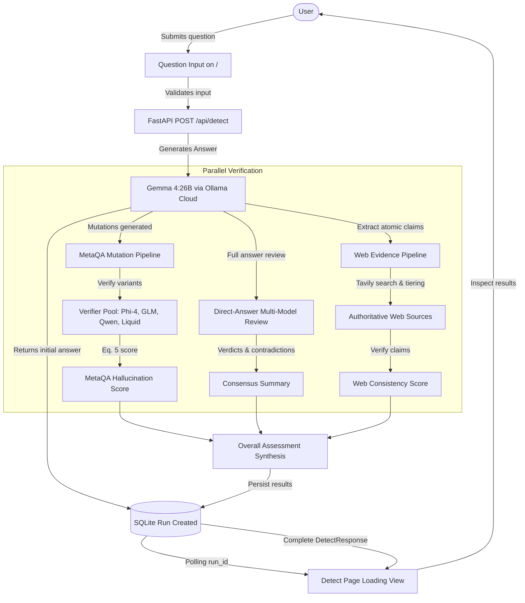

# VeriFact — Product Requirements Document (PRD)

**Project Title**: *VeriFact: A MetaQA-Based Framework for Detecting Fact-Conflicting Hallucinations in Large Language Models*
**Document Version**: 1.0.0 (Release Freeze)
**Status**: Feature-Complete & Quality-Audited
**Target Repository**: `RohanSingh-2003/verifact`

---

## 1. Product Overview & Vision

VeriFact is an explainable, dual-pipeline AI hallucination detection and factual consistency evaluation system. Designed as a rigorous research prototype and interactive verification platform, VeriFact addresses a fundamental defect in modern generative artificial intelligence: Large Language Models (LLMs) frequently generate fact-conflicting, fabricated, or internally contradictory assertions with high linguistic fluency and uncalibrated confidence.

Rather than relying on naive self-reflection (which suffers from self-confirmation bias, sycophancy, and shared blind spots), VeriFact evaluates AI-generated answers through two orthogonal, complementary verification branches backed by cross-model multi-agent review:

1. **Internal Metamorphic Consistency (MetaQA Pipeline)**: A reference-free metamorphic testing engine based on Yang et al. (*ACM FSE 2025*). It evaluates whether an answer's underlying knowledge state remains consistent under controlled semantic perturbations (meaning-preserving synonym mutations and meaning-reversing antonym/negation mutations), verified concurrently by an independent cloud model pool.
2. **External Factual Grounding (Web Evidence Pipeline)**: An external retrieval and verification engine grounded in the methodology of ClaimCheck (*ACL KnowledgeNLP 2025*). It extracts atomic factual claims from the generated answer, executes targeted search queries via Tavily, ranks sources across a 6-tier domain authority hierarchy, extracts relevant passages, and assesses claim support strictly against retrieved text.
3. **Direct-Answer Multi-Model Peer Review**: A concurrent evaluation pipeline where diverse independent models evaluate the generated text, pinpointing logical contradictions and factual discrepancies without allowing the generating model to review itself.

The dual verification streams culminate in an application-level **Overall VeriFact Assessment** that presents synthesized risk indicators alongside transparent, inspectable evidence without collapsing or corrupting the underlying research scores.

---

## 2. Problem Statement & Motivation

### 2.1 The Hallucination Crisis in Generative LLMs
While state-of-the-art LLMs demonstrate impressive fluent reasoning, they exhibit systemic hallucination vulnerabilities:
- **Fact-Conflicting Hallucinations**: Statements that contradict established real-world facts, dates, entities, or relationships.
- **Metamorphic Instability**: Models provide affirmative answers to a question, but reverse their verdict when a premise is phrased using synonyms, or affirm mutually exclusive negated premises.
- **Self-Verification Failure**: When asked *"Are you sure?"* or prompted to critique their own output, LLMs frequently double down on errors or hallucinate justifications to defend their initial generation.

### 2.2 Shortcomings of Single-Method Approaches
- **Pure Web Search**: Vulnerable to SEO spam, search engine coverage gaps, outdated documentation, and keyword drift. Absence of evidence is often conflated with evidence of falsehood.
- **Pure Self-Consistency**: Measures internal certainty, but an LLM can be consistently wrong about established facts.
- **Direct Multi-Model Voting**: Simple majority voting fails when multiple models inherit shared training corpus biases.

VeriFact overcomes these limitations by combining **reference-free metamorphic perturbation testing** with **external authority-tiered web retrieval** and **cross-architecture multi-model peer review**.

---

## 3. Target Users & Needs

| Persona | Description | Core Needs |
|---|---|---|
| **AI Safety & NLP Researchers** | Academics and laboratory researchers evaluating metamorphic testing, consistency scoring, and hallucination metrics. | Deterministic scoring formulas (Yang et al. Eq. 5), immutable benchmark datasets (`pilot.json`), uncorrupted component metrics, and reproducibility. |
| **Applied ML Engineers** | Developers integrating LLMs into high-stakes domains (healthcare, legal, finance, customer support). | Clear REST API contracts, graceful fallback handling, transparent execution latencies, and actionable verdicts rather than black-box confidence numbers. |
| **Enterprise Fact-Checkers & Analysts** | Non-technical and technical domain experts auditing AI-generated summaries and claims. | Soothing, readable user interfaces; human-readable formula explanations; clear source citations with domain authority tiers; and inspectable model reasoning. |

---

## 4. Product Goals & Objectives

1. **Dual-Pipeline Orthogonality**: Keep internal consistency (MetaQA) and external factual grounding (Web Evidence) completely isolated during execution and scoring. Never blend the Web Evidence Consistency Score into the MetaQA Hallucination Score.
2. **Strict Answer-Generator Exclusion**: Guarantee that the answer-generating model (Gemma 4:26B) is never permitted to evaluate its own outputs, mutations, or claims.
3. **Human-Readable Transparency**: Render mathematical equations cleanly without broken entities, explaining scoring mechanics in plain English so ordinary users understand the evaluation.
4. **Deterministic Reproducibility**: Ensure fixed thresholds ($\theta = 0.50$), reproducible metamorphic mutation operators, and locked baseline experiment audits (`58baff20-fb86-4f43-b20e-895a086ceb6b`).
5. **Calm, High-Contrast Usability**: Deliver a soothing, desaturated visual system with full Light, Dark, and System theme support, maintaining unambiguous semantic color indicators (green = supported/reliable, red = contradicted/hallucinated, amber = uncertain/insufficient).

---

## 5. Functional Requirements

### 5.1 AI Answer Generation
- **FR-1.1**: The system must accept user questions through an interactive input field or the `POST /api/detect` REST endpoint.
- **FR-1.2**: Answers must be generated exclusively by **Gemma 4:26B** hosted via **Ollama Cloud** (`gemma4:26b`).
- **FR-1.3**: Empty, whitespace-only, or malformed question submissions must be intercepted client-side and validated server-side, returning `HTTP 422 Unprocessable Entity`.
- **FR-1.4**: Answer generation latency must be measured and recorded (`timing.answer_generation_ms`).

### 5.2 MetaQA Metamorphic Consistency Testing
- **FR-2.1**: The system must extract key testable sentences from the generated answer and produce controlled semantic mutations:
  - **Synonym Mutations**: At least 3 meaning-preserving variations per sentence.
  - **Antonym & Negation Mutations**: At least 3 meaning-reversing variations per sentence.
- **FR-2.2**: Mutations must be evaluated by the **Independent Verifier Pool** (Phi-4 Reasoning, GLM-4.7-Flash, Qwen-2.5-32B, Liquid LFM-2.5).
- **FR-2.3**: Verifier responses must be mapped to discrete verdicts: `YES` (1.0 or 0.0 penalty depending on mutation kind), `NO`, or `NOT SURE` (0.5 neutral penalty).
- **FR-2.4**: The final MetaQA Hallucination Score ($S \in [0.0, 1.0]$) must be calculated strictly according to Equation 5 of Yang et al.:
  $$S = \frac{1}{2} \left( \frac{1}{|M_{\text{syn}}|} \sum_{m \in M_{\text{syn}}} \text{penalty}(m) + \frac{1}{|M_{\text{ant}}|} \sum_{m \in M_{\text{ant}}} \text{penalty}(m) \right)$$
- **FR-2.5**: The system must classify the answer as `Likely Hallucinated` if $S \ge 0.50$ and `Likely Reliable` if $S < 0.50$.

### 5.3 Independent Multi-Model Peer Review
- **FR-3.1**: The four independent cloud models must concurrently evaluate Gemma's complete answer against the question, extracted claims, and mutation context.
- **FR-3.2**: Each model must output a structured verdict (`Correct`, `Incorrect`, or `Uncertain`), a confidence score, concise rationale, and any identified contradictory claims.
- **FR-3.3**: The system must synthesize a consensus summary detecting whether agreement or conflicting assessments exist. Disagreements must be flagged prominently without treating majority vote as mathematical truth.

### 5.4 Web Evidence Retrieval & Factual Grounding
- **FR-4.1**: The system must decompose Gemma's answer into up to 3 atomic, verifiable factual claims.
- **FR-4.2**: The system must execute multi-pass keyword queries via the **Tavily Search API** (search depth: `basic`, max searches per claim: 3).
- **FR-4.3**: Retrieved sources must be filtered against a relevance threshold ($\ge 0.20$) to discard off-topic content.
- **FR-4.4**: Surviving sources must be categorized into 6 domain authority tiers:
  - *Tier 1*: Primary & Official (`.gov`, `.edu`, official documentation)
  - *Tier 2*: Academic & Research (`arxiv.org`, peer-reviewed journals)
  - *Tier 3*: Reputable News & Fact-Check (Reuters, AP, BBC, Snopes)
  - *Tier 4*: Reference & Encyclopedias (Wikipedia, Britannica)
  - *Tier 5*: General Web (commercial sites, blogs)
  - *Tier 6*: Low Priority (forums, social media)
- **FR-4.5**: Each assessed claim must receive an evidence verdict:
  - `SUPPORTED` (Contribution: 1.0)
  - `INSUFFICIENT_EVIDENCE` (Contribution: 0.5)
  - `CONTRADICTED` (Contribution: 0.0)
  - `NOT_ASSESSED_NO_RELEVANT_SOURCE` (Excluded from calculation)
- **FR-4.6**: The Web Evidence Consistency Score must equal the arithmetic mean of all assessed claims:
  $$\text{Consistency Score} = \frac{1}{|C_{\text{assessed}}|} \sum_{c \in C_{\text{assessed}}} \text{contribution}(c)$$
  If no claims have relevant sources, no score is produced (`null`).

### 5.5 Combined Assessment & Synthesis
- **FR-5.1**: The system must compute an application-level combined risk score that reflects joint signals from MetaQA and Web Evidence without overwriting either component score.
- **FR-5.2**: The UI must display an executive verdict (`Likely Reliable`, `Uncertain / Needs Review`, `Likely Hallucinated`) with clear breakdown cards.

### 5.6 Run History & Persistence
- **FR-6.1**: Every completed or failed run must be persisted in a local SQLite database (`db/verifact.db`).
- **FR-6.2**: The History page (`/history`) must display past questions, timestamps, model identifiers, scores, and status badges.
- **FR-6.3**: Users must be able to click any historical run to inspect the complete saved analysis without re-executing API calls.

### 5.7 Settings & Visual Customization
- **FR-7.1**: The Settings page (`/settings`) must allow users to toggle between `Light`, `Dark`, and `System` appearance preferences.
- **FR-7.2**: The Settings page must display the live configuration status (`Configured` vs `Not configured`) for all 5 models and Tavily without exposing raw credentials or secrets.

---

## 6. Non-Functional Requirements

### 6.1 Reliability & Concurrency
- Long-running verification tasks must execute asynchronously via FastAPI background tasks or asyncio pools.
- The frontend must poll `/api/runs/{run_id}` gracefully, updating progress indicators without locking the interface.
- Transient API timeouts or rate limits from external cloud providers must be retried with exponential backoff and captured defensively without crashing the application.

### 6.2 Security & Credential Protection
- API keys (`OLLAMA_API_KEY`, `OPENROUTER_API_KEY`, `CLOUDFLARE_API_TOKEN`, `GROQ_API_KEY`, `TAVILY_API_KEY`) must never be transmitted to the client, logged in plaintext, or committed to Git.
- Outgoing external links to web sources must be sanitized with `rel="noopener noreferrer"`.
- User input must be parameterized to prevent SQL injection in SQLite queries.

### 6.3 Usability & Accessibility
- The interface must follow WCAG AA contrast standards across both light and dark modes.
- Mathematical formulas must wrap cleanly on mobile screens and include plain-English explanations.
- All interactive controls must support keyboard navigation and descriptive ARIA roles.

### 6.4 Maintainability & Research Integrity
- Protected research experiment outputs (`experiments/results/`) and evaluation benchmarks (`pilot.json`) are immutable.
- Evaluation formulas, metamorphic mutation operators, and classification thresholds must remain stable across updates.

---

## 7. User Workflows

---

## 8. Out-of-Scope & Known Limitations

1. **Not Real-Time Conversational Chat**: VeriFact is an analytical verification engine, not a conversational chatbot. Each run is a discrete, single-turn analysis.
2. **Search Coverage Bounds**: Web Evidence is limited by Tavily's indexed web content. Very recent news (last few hours) or paywalled articles may produce `INSUFFICIENT_EVIDENCE`.
3. **Absence is Not Falsity**: If no relevant online sources exist for a niche or personal query, VeriFact assigns `NOT_ASSESSED_NO_RELEVANT_SOURCE` and excludes the claim from the consistency score. It does not declare the claim false.
4. **Non-Probability Scores**: Hallucination and consistency scores represent normalized heuristic penalties and bounded metrics; they are not calibrated Bayesian probabilities of factual truth.
5. **No Automated Self-Correction**: VeriFact analyzes and explains hallucinations; it does not rewrite or edit the model's generated answer.

---

## 9. Acceptance Criteria (Verified)

- [x] All 5 models in `MODEL_REGISTRY` accurately identified with their real provider endpoints.
- [x] Gemma 4:26B generates answers and mutations, but is excluded from the verifier pool.
- [x] Equation 5 renders stacked fractions without malformed entities (`&frac`, `&Biggl`).
- [x] Web Evidence Consistency Score clearly defined as average contribution of assessed claims.
- [x] Source Quality Tiers 1 through 6 visually distinct with calm, muted colors.
- [x] Settings page free of decorative icons; displays accurate `Configured` status badges.
- [x] All 491 backend unit/integration tests and 26 frontend tests pass cleanly.
- [x] Frontend builds into optimized production bundle without TypeScript or lint errors.
