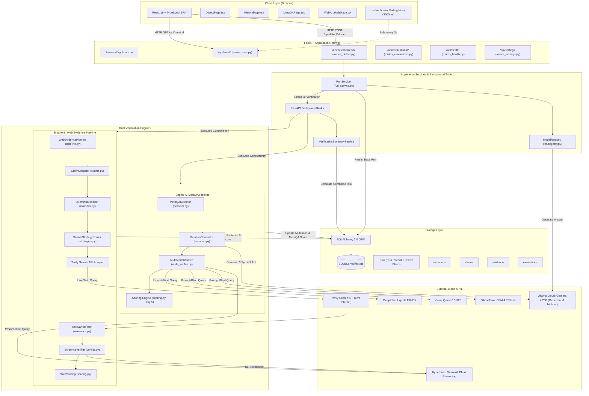

# VeriFact

> **Dual-Engine Automated Hallucination Detection & Fact-Verification for Large Language Models**

[](https://fastapi.tiangolo.com)
[](https://react.dev)
[](https://www.typescriptlang.org)
[](https://www.python.org)
[](https://tailwindcss.com)
[](https://www.sqlite.org)
[](https://tavily.com)
[](LICENSE)

---

## Table of Contents

- [A. Project Introduction](#a-project-introduction)
  - [What is VeriFact?](#what-is-verifact)
  - [The Problem: Fact-Conflicting Hallucinations](#the-problem-fact-conflicting-hallucinations)
  - [Why Self-Reflection Fails](#why-self-reflection-fails)
  - [What Makes VeriFact Different](#what-makes-verifact-different)
  - [Key Capabilities](#key-capabilities)
- [B. Features](#b-features)
- [C. System Architecture](#c-system-architecture)
  - [Architectural Topology](#architectural-topology)
  - [Communication Flow](#communication-flow)
- [D. Complete End-to-End Workflow](#d-complete-end-to-end-workflow)
  - [Execution Journey](#execution-journey)
  - [Execution Flowchart](#execution-flowchart)
- [E. AI/ML Concepts & Implementation](#e-aiml-concepts--implementation)
  - [1. LLM-Based Answer Generation](#1-llm-based-answer-generation)
  - [2. Hallucination Detection](#2-hallucination-detection)
  - [3. Metamorphic Testing (MetaQA)](#3-metamorphic-testing-metaqa)
  - [4. Synonym and Antonym Mutations](#4-synonym-and-antonym-mutations)
  - [5. Prompt-Blind Multi-Model Verification](#5-prompt-blind-multi-model-verification)
  - [6. Atomic Claim Extraction](#6-atomic-claim-extraction)
  - [7. Authority-Aware Web Evidence Retrieval](#7-authority-aware-web-evidence-retrieval)
  - [8. Topical Relevance Filtering](#8-topical-relevance-filtering)
  - [9. Compound-Claim Decomposition & NLI Evidence Classification](#9-compound-claim-decomposition--nli-evidence-classification)
  - [10. Score Calculation & Assessment Fusion](#10-score-calculation--assessment-fusion)
- [F. Technology Stack](#f-technology-stack)
- [G. Repository Structure](#g-repository-structure)
- [H. Installation and Setup](#h-installation-and-setup)
  - [Prerequisites](#prerequisites)
  - [1. Clone the Repository](#1-clone-the-repository)
  - [2. Backend Setup](#2-backend-setup)
  - [3. Frontend Setup](#3-frontend-setup)
  - [4. Running the Complete System](#4-running-the-complete-system)
- [I. Environment Variables](#i-environment-variables)
- [J. API Documentation](#j-api-documentation)
- [K. Models and Providers](#k-models-and-providers)
- [L. Scoring and Risk Assessment](#l-scoring-and-risk-assessment)
  - [MetaQA Inconsistency Score (Equation 5)](#metaqa-inconsistency-score-equation-5)
  - [Web Evidence Consistency Score](#web-evidence-consistency-score)
  - [Combined Hallucination Risk Formula](#combined-hallucination-risk-formula)
  - [Categorical Verdict Matrix](#categorical-verdict-matrix)
  - [Honest Theoretical Limitations](#honest-theoretical-limitations)
- [M. Testing & Quality Assurance](#m-testing--quality-assurance)
  - [Backend Pytest Suite](#backend-pytest-suite)
  - [Frontend Vitest Suite & Linting](#frontend-vitest-suite--linting)
  - [Offline Mock Testing](#offline-mock-testing)
- [N. Limitations and Future Improvements](#n-limitations-and-future-improvements)
- [O. Project Status and License](#o-project-status-and-license)
- [P. Documentation Navigation](#p-documentation-navigation)

---

## A. Project Introduction

### What is VeriFact?
**VeriFact** is an explainable, dual-engine hallucination detection and fact-verification system designed to evaluate whether answers generated by Large Language Models (LLMs) are factual, internally consistent, and backed by verifiable evidence.

Rather than relying on naive self-evaluation, VeriFact subjects an AI-generated answer to two independent evaluation engines:
1. **Engine A: MetaQA (Internal Metamorphic Consistency Engine)** — Evaluates whether the model's underlying knowledge state remains logically invariant when its statements are perturbed into meaning-preserving synonyms and meaning-reversing antonyms/negations, verified by a pool of independent cross-model verifiers.
2. **Engine B: Web Evidence (External Grounding Engine)** — Extracts atomic claims from the answer, routes domain-specific search queries through the Tavily Search API to authoritative sources, filters retrieved snippets for topical relevance, and verifies each claim against external documents.

An application-level synthesis layer then computes a **Combined Hallucination Risk** score while strictly preserving the independent research metrics.

---

### The Problem: Fact-Conflicting Hallucinations
Generative LLMs are trained to maximize token likelihood given prior context. While they produce fluent, coherent, and grammatically impeccable text, they frequently output **fact-conflicting hallucinations**—assertions that contradict real-world facts, historical records, scientific consensus, or established documentation.

In high-stakes domains such as medicine, law, engineering, and finance, undetected hallucinations can lead to critical failures, misinformation, and erroneous decision-making.

---

### Why Self-Reflection Fails
A common naive approach is "self-reflection": prompting the generator model to review its own output (*"Are you sure this answer is correct? Please check for mistakes."*). Research demonstrates that self-reflection systematically fails due to three fundamental issues:
- **Model Sycophancy & Confirmation Bias**: LLMs conditioned on their own generated tokens exhibit inflated confidence in their prior output.
- **Corrupted Latent Priors**: If an LLM's weights associate false entities (e.g., believing an event occurred in the wrong decade), prompting the same model merely samples from the same corrupted latent distribution.
- **Prompt Contamination**: Exposing the evaluator to the full original context cues the model to rationalize its prior reasoning rather than auditing the factual assertion objectively.

---

### What Makes VeriFact Different
- **Strict Generator Exclusion**: The model that writes the answer (**Gemma 4:26B**) is mathematically and architecturally prohibited from verifying its own answers or mutations.
- **Prompt Blindness**: Verifier models evaluate atomic propositions in isolation, without seeing the user prompt, original conversation, or expected outcome.
- **Orthogonal Dual-Engine Verification**: VeriFact tests both **internal cognitive consistency** (metamorphic logic) and **external empirical grounding** (live authoritative web retrieval).
- **Asynchronous Decoupled Execution**: The candidate answer is generated and delivered to the user immediately (`answer_ready`), while the intensive multi-model verification pipelines execute concurrently in the background.

---

### Key Capabilities
- **Instant Candidate Generation**: Generates responses in seconds via Gemma 4:26B on Ollama Cloud.
- **Automated Metamorphic Mutation**: Automatically parses answers into claims and generates 3 synonym and 3 antonym mutations.
- **Cross-Model Verifier Pool**: Concurrently queries Microsoft Phi-4 Reasoning, GLM-4.7-Flash, Qwen-2.5-32B, and Liquid LFM-2.5 under strict prompt blindness.
- **Direct-Answer Peer Review**: Concurrently obtains structured peer reviews (`Correct`, `Incorrect`, `Uncertain`) and synthesizes quorum consensus.
- **Authority-Aware Web Retrieval**: Categorizes questions into 8 domains and queries tier-1 sources (`.gov`, `.edu`, PubMed, Nature, Reuters) via Tavily Search with open web fallback.
- **Topical Relevance Filtering**: Applies a word-token overlap threshold ($\ge 0.20$) to purge noisy or irrelevant web search snippets.
- **Transparent Composite Scoring**: Visualizes individual claim verdicts, mutation penalties, Web Consistency Score, MetaQA Inconsistency Score, and Combined Hallucination Risk.

---

## B. Features

| Feature | Category | Description | Implementation Status |
| :--- | :--- | :--- | :--- |
| **Gemma 4:26B Generation** | Core LLM | Generates base answers via Ollama Cloud API (`https://ollama.com/api`) with reasoning suppression (`think: false`). | **Fully Implemented** |
| **MetaQA Mutation Generation** | Engine A | Generates 3 synonym and 3 antonym mutations bounded between 5 and 35 words. | **Fully Implemented** |
| **Prompt-Blind Verification** | Engine A | Queries non-Gemma verifier pool on isolated propositions with zero question context. | **Fully Implemented** |
| **Equation 5 Penalty Scoring** | Engine A | Computes normalized mean penalty ($0.0$ for consistent, $1.0$ for violation, $0.5$ for uncertainty). | **Fully Implemented** |
| **Direct Peer Review** | Multi-Model | Evaluates Gemma's full answer text across peer models; calculates quorum consensus. | **Fully Implemented** |
| **Atomic Claim Extraction** | Engine B | Decomposes answers into up to 3 testable, self-contained factual assertions. | **Fully Implemented** |
| **Domain Classification** | Engine B | Classifies queries into 8 specialized categories to select targeted authority tiers. | **Fully Implemented** |
| **2-Pass Web Search** | Engine B | Queries Tavily Search: Pass 1 on domain whitelists; Pass 2 on open web if Pass 1 yields 0 hits. | **Fully Implemented** |
| **Topical Relevance Filter** | Engine B | Token overlap filter ($\ge 0.20$) discarding off-topic or spam snippets. | **Fully Implemented** |
| **Compound-Claim Check** | Engine B | Checks multi-part assertions; downgrades to `INSUFFICIENT_EVIDENCE` if coverage is partial. | **Fully Implemented** |
| **NLI Claim Classification** | Engine B | Assigns `SUPPORTED`, `CONTRADICTED`, `INSUFFICIENT_EVIDENCE`, or `NOT_ASSESSED_NO_RELEVANT_SOURCE`. | **Fully Implemented** |
| **Combined Risk Synthesis** | Application | Linear fusion: $0.5 \times \text{MetaQA} + 0.5 \times (1.0 - \text{WebConsistency})$. | **Fully Implemented** |
| **Progressive UI Polling** | Frontend | Polls `/api/runs/{id}` every 3000ms, progressively rendering cards as background tasks finish. | **Fully Implemented** |
| **Audit Log & History** | Frontend | Interactive historical run table with search, status filtering, and individual run inspection. | **Fully Implemented** |
| **Frozen 550 Benchmark** | Evaluation | 550 standardized questions (400 TruthfulQA, 150 FreshQA) with ground truth adjudication. | **Fully Implemented** |
| **Frontend Model Selector** | Frontend | `AnswerModelSelector.tsx` UI component. | **Dead Code** (Gemma 4:26B is hardcoded) |
| **Separate Verdicts Table** | Database | Relational table `MODEL_VERDICTS`. | **Not Used** (Stored as JSON in `runs` and `mutations`) |

---

## C. System Architecture

VeriFact follows a clean, decoupled architecture:
- **Presentation Layer**: React 19 SPA built with TypeScript, Tailwind CSS v4, and Vite 8.
- **API Gateway & Orchestration**: FastAPI running on Python 3.10+ ASGI with Uvicorn.
- **Persistence Layer**: SQLite3 database (`verifact.db`) managed via SQLAlchemy 2.0 ORM.
- **Inference Layer**: Asynchronous HTTP clients connecting to Ollama Cloud, Hyperbolic, SiliconFlow, Groq, and DeepInfra.
- **Search Layer**: Tavily Search API client with domain whitelist filters and rate-limiting.

### Architectural Topology



---

### Communication Flow
1. **Frontend Reverse Proxy**: In development, Vite (`http://localhost:5173`) proxies `/api` requests directly to FastAPI (`http://127.0.0.1:8000`), eliminating CORS complications.
2. **Immediate Handshake**: The user submits a question via `POST /api/detect/stream`. The backend generates the answer with Gemma 4:26B, stores the run with `status="RUNNING"`, and returns the base answer immediately.
3. **Background Dispatch**: FastAPI schedules verification pipelines as background tasks (`BackgroundTasks`).
4. **Reactive Polling**: The frontend hook `useVerificationPolling` polls `GET /api/runs/{id}` every 3,000 milliseconds.
5. **State Finalization**: Once background workers write the final scores, the run transitions to `status="COMPLETED"`, polling halts, and full scorecards render.

---

## D. Complete End-to-End Workflow

```mermaid
sequenceDiagram
    autonumber
    actor User as User (Browser)
    participant UI as React Frontend (DetectPage.tsx)
    participant API as FastAPI (routes_detect.py)
    participant Service as RunService (run_service.py)
    participant Gemma as Ollama (Gemma 4:26B)
    participant DB as SQLite (verifact.db)
    participant BG as BackgroundTasks Worker
    participant MetaQA as MetaQA Pipeline
    participant Web as Web Evidence Pipeline
    participant Verifiers as Non-Gemma Model Pool
    participant Tavily as Tavily Search Engine

    User->>UI: Types question & clicks "Run Verification"
    UI->>API: POST /api/detect/stream { question: "...", model: "gemma4:26b" }
    API->>API: Validate request schema (enforce model = "gemma4:26b")
    API->>Service: create_and_start_run(question)
    Service->>Gemma: generate_answer(question) [think: false]
    Gemma-->>Service: Base answer text
    Service->>DB: INSERT INTO runs (status='RUNNING', answer='...')
    Service->>BG: enqueue background_verification_task(run_id)
    Service-->>API: Yields Run entity
    API-->>UI: 200 OK { id: "run_uuid", answer: "...", status: "RUNNING" }
    
    UI->>UI: Render base answer immediately in AnswerCard
    UI->>UI: Start useVerificationPolling hook (interval: 3000ms)

    par Parallel Background Execution
        BG->>MetaQA: run_metaqa_pipeline(run_id, answer)
        MetaQA->>Gemma: generate_mutations(answer) [3 Synonyms + 3 Antonyms]
        Gemma-->>MetaQA: 6 mutated statements (bounded 5-35 words)
        loop For each mutation across all Verifier Models
            MetaQA->>Verifiers: verify_mutation(mutation_text) [Blind evaluation]
            Verifiers-->>MetaQA: Verdict: YES / NO / NOT SURE
        end
        MetaQA->>MetaQA: Compute MetaQA Score (Equation 5)
        MetaQA->>DB: INSERT INTO mutations; UPDATE runs SET metaqa_score=...
    and
        BG->>Web: run_web_pipeline(run_id, answer)
        Web->>Gemma: extract_claims(answer) [Max 3 atomic claims]
        Gemma-->>Web: Claims JSON
        Web->>Web: classify_domain(question) -> Select authority tier
        Web->>Tavily: Search Pass 1 (Domain Whitelist)
        opt If Pass 1 returns 0 results
            Web->>Tavily: Search Pass 2 (Open Web Fallback)
        end
        Tavily-->>Web: Snippets & source URLs
        Web->>Web: filter_relevance(overlap >= 0.20)
        loop For each verified claim
            Web->>Verifiers: evaluate_evidence_entailment(claim, snippets)
            Verifiers-->>Web: Verdict: SUPPORTED / CONTRADICTED / INSUFFICIENT
        end
        Web->>Web: Compute Web Consistency Score
        Web->>DB: INSERT INTO claims, evidence; UPDATE runs SET web_score=...
    end

    BG->>Service: calculate_combined_risk()
    Service->>DB: UPDATE runs SET status='COMPLETED', combined_risk=...
    
    UI->>API: GET /api/runs/run_uuid (Poll)
    API->>DB: SELECT * FROM runs WHERE id='run_uuid'
    DB-->>API: Completed Run entity + relations
    API-->>UI: 200 OK { status: 'COMPLETED', metaqa_score: 0.12, web_score: 0.88, ... }
    UI->>UI: Stop polling; render detailed scorecards, mutations, and evidence links
```

---

## E. AI/ML Concepts & Implementation

### 1. LLM-Based Answer Generation
- **Concept**: Generative sampling of token sequences from a frozen parameter distribution.
- **Why Used**: Provides candidate answers for factual analysis.
- **How Implemented**: Executed by **Gemma 4:26B** via the official Ollama Cloud API (`https://ollama.com/api`). Configured with `think: false` to suppress internal chain-of-thought tokens and keep latency low within a 350-token budget.

### 2. Hallucination Detection
- **Concept**: Automated classification of machine-generated text as factual or fabricated.
- **Why Used**: Generative models cannot reliably self-audit.
- **How Implemented**: Multi-branch pipeline combining internal consistency testing with external live web retrieval.

### 3. Metamorphic Testing (MetaQA)
- **Concept**: Software testing methodology for programs lacking an oracle (ground truth). It tests whether necessary relations (*metamorphic relations*) hold between multiple inputs and outputs.
- **Why Used**: Allows hallucination detection without requiring a pre-existing ground truth answer.
- **How Implemented**: If statement $A$ is asserted, its synonym paraphrasing $S(A)$ must also evaluate to true (`YES`), while its negation/antonym $N(A)$ must evaluate to false (`NO`). Contradictions violate metamorphic invariants.

### 4. Synonym and Antonym Mutations
- **Concept**: Semantic transformations preserving or inverting truth value.
- **Why Used**: Probes the boundary of the model's factual commitment.
- **How Implemented**: Gemma 4:26B produces 3 synonym and 3 antonym mutations bounded between 5 and 35 words using structured JSON prompts.

### 5. Prompt-Blind Multi-Model Verification
- **Concept**: Evaluating a proposition without exposing the evaluator to the original question or context.
- **Why Used**: Prevents context cues from biasing the verifier toward agreeing with the generated answer.
- **How Implemented**: Non-Gemma verifiers (Microsoft Phi-4, GLM-4.7-Flash, Qwen-2.5-32B, Liquid LFM-2.5) receive only the mutated proposition and return `YES`, `NO`, or `NOT SURE`.

### 6. Atomic Claim Extraction
- **Concept**: Splitting compound paragraphs into discrete, independently verifiable propositions.
- **Why Used**: Web search engines cannot verify complex multi-clause paragraphs effectively.
- **How Implemented**: Gemma 4:26B extracts up to 3 atomic claims with pronouns resolved into explicit named entities.

### 7. Authority-Aware Web Evidence Retrieval
- **Concept**: Grounding factual assertions in external documents using domain-tailored search.
- **Why Used**: Protects against model-wide shared training biases.
- **How Implemented**: Rule-based classifier maps queries to 8 domains. Tavily Search executes Pass 1 against official domain whitelists (`.gov`, `.edu`, PubMed, Nature, Reuters), falling back to open web search in Pass 2.

### 8. Topical Relevance Filtering
- **Concept**: Discarding irrelevant or noisy search snippets before verification.
- **Why Used**: Search engines often return navigation menus, cookie policies, or tangential news.
- **How Implemented**: Deterministic token overlap filter (`relevance.py`). Strips stopwords, tokenizes lowercase alphanumeric terms, and requires $\ge 0.20$ token overlap with the claim.

### 9. Compound-Claim Decomposition & NLI Evidence Classification
- **Concept**: Determining whether a premise text entails or contradicts a hypothesis.
- **Why Used**: Produces an objective verdict based strictly on retrieved text.
- **How Implemented**: Prompts an independent reasoning model (Phi-4) to evaluate entailment strictly against the retrieved snippet. If a compound claim has partial coverage, it is conservatively classified as `INSUFFICIENT_EVIDENCE`.

### 10. Score Calculation & Assessment Fusion
- **Concept**: Combining distinct verification signals into an interpretable metric.
- **Why Used**: Users need an executive verdict while researchers need raw independent scores.
- **How Implemented**: Deterministic Python functions compute the MetaQA Inconsistency Score (Equation 5), Web Consistency Score, and Combined Hallucination Risk ($0.5 \times \text{MetaQA} + 0.5 \times (1.0 - \text{WebScore})$).

---

## F. Technology Stack

### Backend
- **Python**: `3.10+` (modern typing syntax, `asyncio`)
- **FastAPI**: `^0.110.0` (REST API gateway, OpenAPI docs, async background tasks)
- **Uvicorn**: `^0.28.0` (ASGI production application server)
- **SQLAlchemy**: `^2.0.28` (modern Python ORM with SQLite backend)
- **Pydantic**: `^2.6.4` (data validation and typed application settings)
- **Alembic**: `^1.13.1` (database schema migration tooling)
- **HTTPX**: `^0.27.0` (async HTTP client for Ollama Cloud and external APIs)

### Frontend
- **React**: `^19.2.8` (reactive single-page application framework)
- **TypeScript**: `~6.0.2` (strict static typing across UI state and APIs)
- **Vite**: `^8.2.2` (lightning-fast HMR and build bundler)
- **Tailwind CSS**: `^4.3.3` with `@tailwindcss/vite` (utility-first modern CSS)
- **React Router DOM**: `^7.18.3` (client-side routing)
- **Lucide React**: `^1.40.0` (clean vector iconography)

### AI Models & Cloud Inference
- **Ollama Cloud API**: Hosts **Gemma 4:26B** (`gemma4:26b`) for answer generation and mutation synthesis
- **Hyperbolic API / OpenRouter**: Hosts **Microsoft Phi-4 Reasoning** (`microsoft/phi-4-reasoning`)
- **SiliconFlow API / Cloudflare Workers AI**: Hosts **GLM-4.7-Flash** (`glm-4.7-flash`)
- **Groq Cloud API**: Hosts **Qwen-2.5-32B** (`qwen-2.5-32b`) on high-throughput LPUs
- **DeepInfra API**: Hosts **Liquid LFM-2.5** (`liquid/lfm-2.5-1.2b`)

### Search & External Services
- **Tavily Search API**: `tavily-python ^0.3.1` (LLM-optimized real-time web search and snippet extraction)

### Database
- **SQLite3**: Transactional relational storage with WAL (Write-Ahead Logging) mode enabled

### Testing & Development Tools
- **Pytest**: `^8.1.1` (backend automated test runner with 607 unit tests)
- **Vitest**: `^5.0.3` (frontend component test runner)
- **Oxlint**: `^1.79.0` (high-performance JavaScript/TypeScript linter)

---

## G. Repository Structure

```text
verifact/
├── backend/                                # FastAPI backend application
│   ├── app/
│   │   ├── api/                            # REST route controllers
│   │   │   ├── routes_detect.py            # POST /api/detect/stream
│   │   │   ├── routes_runs.py              # GET/DELETE /api/runs/*
│   │   │   ├── routes_evaluations.py       # POST /api/evaluations/*
│   │   │   ├── routes_health.py            # GET /api/health
│   │   │   └── routes_settings.py          # GET /api/settings
│   │   ├── database/                       # SQLAlchemy models & DB connection
│   │   │   ├── db.py                       # Engine & SessionLocal setup
│   │   │   └── models.py                   # Run, Mutation, Claim, Evidence models
│   │   ├── evaluation/                     # Benchmark evaluation engine
│   │   │   ├── evaluator.py                # Dataset evaluation coordinator
│   │   │   ├── ground_truth.py             # Reference answer comparison
│   │   │   ├── metrics.py                  # P/R/F1, confusion matrix, sweeps
│   │   │   └── dataset_loader.py           # Benchmark JSON/CSV loading
│   │   ├── llm/                            # Cloud LLM client implementations
│   │   │   ├── registry.py                 # Multi-model registry & verifier pool
│   │   │   ├── providers.py                # OllamaCloudClient, GeminiAdapter, etc.
│   │   │   └── mock.py                     # Deterministic test mock fixtures
│   │   ├── metaqa/                         # Engine A: MetaQA Metamorphic Testing
│   │   │   ├── detector.py                 # MetaQA pipeline coordinator
│   │   │   ├── mutation.py                 # 3 Synonym + 3 Antonym generator
│   │   │   ├── multi_verifier.py           # Cross-model prompt-blind verifier
│   │   │   └── scoring.py                  # Equation 5 penalty scoring engine
│   │   ├── web_evidence/                   # Engine B: Web Evidence Grounding
│   │   │   ├── pipeline.py                 # Web evidence coordinator
│   │   │   ├── claims.py                   # Atomic claim extractor
│   │   │   ├── classifier.py               # 8-domain query classifier
│   │   │   ├── strategies.py               # 2-pass search strategy router
│   │   │   ├── relevance.py                # Topical token overlap filter (>= 0.20)
│   │   │   ├── verifier.py                 # NLI claim entailment verifier
│   │   │   └── scoring.py                  # Web Consistency Score engine
│   │   ├── services/                       # Business logic & risk fusion
│   │   │   ├── run_service.py              # Run lifecycle management
│   │   │   └── verification_summary.py     # Combined risk calculation
│   │   ├── config.py                       # Pydantic BaseSettings (.env loading)
│   │   └── main.py                         # Application factory & CORS setup
│   ├── data/
│   │   └── datasets/                       # 550-question formal benchmark
│   │       ├── hallucination_benchmark_frozen.json
│   │       └── hallucination_benchmark_frozen.manifest.json
│   ├── scripts/                            # Dataset & benchmark utility scripts
│   ├── tests/                              # Pytest test suite (607 unit tests)
│   ├── pyproject.toml                      # Backend dependencies & tools
│   └── README.md                           # Backend developer guide
├── frontend/                               # React 19 + TypeScript + Vite UI
│   ├── src/
│   │   ├── components/                     # Modular React UI components
│   │   │   ├── detect/                     # Detect page panels (Answer, MetaQA, Web)
│   │   │   ├── layout/                     # Header, navigation, footer
│   │   │   └── ui/                         # Badges, cards, buttons, modals
│   │   ├── pages/                          # Primary view routes
│   │   │   ├── DetectPage.tsx              # Interactive detection interface
│   │   │   ├── HistoryPage.tsx             # Audit log of previous runs
│   │   │   ├── MetaQAPage.tsx              # Educational guide to MetaQA
│   │   │   ├── WebAnalysisPage.tsx         # Educational guide to Web Evidence
│   │   │   └── SettingsPage.tsx            # Model provider inspection & config
│   │   ├── services/                       # Axios/Fetch API client & mappers
│   │   ├── types/                          # TypeScript domain interfaces
│   │   ├── App.tsx                         # Router configuration
│   │   └── index.css                       # Tailwind v4 utility styles
│   ├── package.json                        # Frontend dependencies & scripts
│   ├── vite.config.ts                      # Reverse proxy & build configuration
│   └── README.md                           # Frontend developer guide
├── docs/                                   # Extended technical documentation
│   ├── COMPLETE_PROJECT_TECHNICAL_AUDIT.md # Exhaustive 15-phase technical audit
│   ├── COMPLETE_SYSTEM_ARCHITECTURE.md     # Component diagrams & contracts
│   ├── END_TO_END_PIPELINES.md             # Execution flowcharts & traces
│   ├── AI_MODELS_AND_ALGORITHMS.md         # KaTeX proofs & worked formulas
│   ├── API_AND_DATABASE_REFERENCE.md       # REST endpoints & SQLite schemas
│   ├── IMPLEMENTATION_STATUS.md            # Code vs doc audit & viva guide
│   ├── final_results_lock.md               # Historical 2x2 mock run audit lock
│   └── README.md                           # Documentation directory index
├── experiments/                            # Historical 2x2 research archive
│   ├── config/                             # Unexecuted live experiment YAML
│   ├── results/                            # Frozen mock run 58baff20 traces
│   └── README.md                           # Experiments archive guide
├── analysis/                               # Research data analysis scripts
│   ├── output/                             # Generated CSVs and PNG figures
│   └── README.md                           # Analysis documentation guide
└── README.md                               # Repository root documentation (this file)
```

---

## H. Installation and Setup

### Prerequisites
- **Python**: Version `3.10` or higher (`3.11` or `3.12` recommended, 64-bit)
- **Node.js**: Version `20` or higher, with `npm`
- **Git**: For cloning the repository
- **API Keys** (for live execution):
  - At least one cloud LLM API key (e.g. `OLLAMA_API_KEY` for Gemma 4:26B)
  - `TAVILY_API_KEY` from [tavily.com](https://tavily.com) for Web Evidence Grounding
  - *Note: For zero-cost offline development and testing, `LLM_MODE=mock` requires no API keys.*

---

### 1. Clone the Repository
```bash
git clone https://github.com/RohanSingh-2003/verifact.git
cd verifact/verifact-main
```

---

### 2. Backend Setup
Open a terminal in the `backend/` directory:

```bash
cd backend

# Create a virtual environment
python -m venv .venv

# Activate the virtual environment
# Windows PowerShell:
.\.venv\Scripts\Activate.ps1
# macOS / Linux:
# source .venv/bin/activate

# Install dependencies
pip install -r requirements.txt

# Create your local environment file
copy .env.example .env
# (macOS/Linux: cp .env.example .env)
```

Configure your API keys in `backend/.env` (see [Environment Variables](#i-environment-variables)).

---

### 3. Frontend Setup
In a second terminal, navigate to the `frontend/` directory:

```bash
cd frontend

# Install Node dependencies
npm install
```

---

### 4. Running the Complete System

#### Start Backend Service (Terminal 1)
```bash
cd backend
.\.venv\Scripts\Activate.ps1
uvicorn app.main:app --host 127.0.0.1 --port 8000 --reload
```
Verify the backend is live by opening [http://127.0.0.1:8000/api/health](http://127.0.0.1:8000/api/health).

#### Start Frontend Service (Terminal 2)
```bash
cd frontend
npm run dev
```
Open your browser at **[http://localhost:5173](http://localhost:5173)**.

---

## I. Environment Variables

Configure these settings in `backend/.env`. **Never commit actual API keys or secret tokens.**

| Variable Name | Purpose | Required / Optional | Default / Example Placeholder |
| :--- | :--- | :--- | :--- |
| `ENVIRONMENT` | Application runtime environment | Optional | `development` |
| `FRONTEND_ORIGIN` | Allowed CORS origin for frontend | Required | `http://localhost:5173` |
| `DATABASE_URL` | SQLite database connection string | Required | `sqlite:///./data/verifact.db` |
| `LLM_MODE` | Execution mode (`live` for cloud APIs, `mock` for test fixtures) | Required | `live` |
| `OLLAMA_CLOUD_BASE_URL` | Ollama Cloud API endpoint | Required for Gemma | `https://ollama.com/api` |
| `OLLAMA_API_KEY` | Ollama Cloud authentication key | Required for Gemma | `your_ollama_cloud_api_key_here` |
| `OLLAMA_CLOUD_MODEL` | Permanent generator model identifier | Required | `gemma4:26b` |
| `OPENROUTER_API_KEY` | OpenRouter API authentication key | Optional (Phi/Liquid) | `your_openrouter_api_key_here` |
| `OPENROUTER_BASE_URL` | OpenRouter API endpoint | Optional | `https://openrouter.ai/api/v1` |
| `OPENROUTER_MODEL` | Liquid LFM model identifier | Optional | `liquid/lfm-2.5-2.6b:free` |
| `PHI_MODEL` | Microsoft Phi-4 model identifier | Optional | `microsoft/phi-4-reasoning:free` |
| `CLOUDFLARE_API_TOKEN`| Cloudflare API token for GLM | Optional (GLM-4.7) | `your_cloudflare_token_here` |
| `CLOUDFLARE_ACCOUNT_ID`| Cloudflare Account ID | Optional | `your_cloudflare_account_id_here` |
| `CLOUDFLARE_MODEL` | GLM model identifier | Optional | `@cf/zai-org/glm-4.7-flash` |
| `GROQ_API_KEY` | Groq Cloud API authentication key | Optional (Qwen) | `your_groq_api_key_here` |
| `GROQ_BASE_URL` | Groq API endpoint | Optional | `https://api.groq.com/openai/v1` |
| `GROQ_MODEL` | Qwen model identifier | Optional | `qwen-2.5-32b` |
| `GEMINI_API_KEY` | Legacy Google Gemini API key | Optional (Disabled) | `your_gemini_api_key_here` |
| `TAVILY_API_KEY` | Tavily Search API authentication key | Required for Web | `your_tavily_api_key_here` |
| `TAVILY_SEARCH_DEPTH` | Tavily search depth (`basic` or `advanced`) | Optional | `basic` |
| `WEB_EVIDENCE_ENABLED` | Toggle Web Evidence verification branch | Optional | `true` |
| `WEB_MAX_CLAIMS` | Maximum atomic claims extracted per answer | Optional | `3` |
| `SYNONYM_COUNT` | Number of synonym mutations generated | Optional | `3` |
| `ANTONYM_COUNT` | Number of antonym mutations generated | Optional | `3` |
| `THRESHOLD` | MetaQA classification threshold $\theta$ | Optional | `0.5` |
| `LLM_TIMEOUT_SECONDS` | Timeout for external LLM API calls | Optional | `60` |

---

## J. API Documentation

### Primary REST Endpoints

#### 1. Submit Detection Stream Request
- **Endpoint**: `POST /api/detect/stream`
- **Purpose**: Generates base answer via Gemma 4:26B, stores initial run, enqueues background verification, and immediately returns the run record.
- **Example Request**:
  ```json
  {
    "question": "Who discovered Penicillin and in what year?",
    "model": "gemma4:26b"
  }
  ```
- **Example Response (200 OK)**:
  ```json
  {
    "id": "3fa85f64-5717-4562-b3fc-2c963f66afa6",
    "question": "Who discovered Penicillin and in what year?",
    "answer": "Penicillin was discovered by Scottish physician Alexander Fleming in 1928 at St. Mary's Hospital in London.",
    "status": "RUNNING",
    "answer_model": "gemma4:26b",
    "created_at": "2026-11-05T20:30:00Z"
  }
  ```

#### 2. Get Run Details & Status
- **Endpoint**: `GET /api/runs/{id}`
- **Purpose**: Polled by frontend every 3000ms. Returns full run state, mutations, claims, evidence, and scores.
- **Example Response (200 OK, Completed)**:
  ```json
  {
    "id": "3fa85f64-5717-4562-b3fc-2c963f66afa6",
    "status": "COMPLETED",
    "metaqa_score": 0.08,
    "metaqa_verdict": "Reliable",
    "web_score": 1.00,
    "web_verdict": "STRONGLY_SUPPORTED",
    "combined_risk": 0.04,
    "overall_verdict": "Likely Reliable",
    "mutations": [
      {
        "mutation_type": "synonym",
        "original_statement": "Penicillin was discovered by Scottish physician Alexander Fleming in 1928.",
        "mutated_statement": "Alexander Fleming, a Scottish doctor, first identified penicillin in the year 1928.",
        "penalty": 0.0
      }
    ],
    "claims": [
      {
        "claim_text": "Alexander Fleming discovered penicillin in 1928.",
        "verdict": "SUPPORTED"
      }
    ]
  }
  ```

#### 3. List Runs (History)
- **Endpoint**: `GET /api/runs?skip=0&limit=20`
- **Purpose**: Returns paginated list of previous runs for the History view.

#### 4. Service Health
- **Endpoint**: `GET /api/health`
- **Purpose**: Returns status of backend and individual cloud LLM provider readiness.

#### 5. Run Offline Evaluation
- **Endpoint**: `POST /api/evaluations/run`
- **Purpose**: Triggers batch evaluation against `hallucination_benchmark_frozen.json`.

---

## K. Models and Providers

| Model Identifier | Cloud Provider / API | Model Role in VeriFact | Execution Status |
| :--- | :--- | :--- | :--- |
| **`gemma4:26b`** | Ollama Cloud (`https://ollama.com/api`) | **Primary Generator & Mutator** | **Active & Enforced** |
| **`microsoft/phi-4-reasoning`** | Hyperbolic / OpenRouter | **Mutation Verifier & NLI Entailment** | **Active** |
| **`glm-4.7-flash`** | SiliconFlow / Cloudflare Workers AI | **Mutation Verifier & Peer Reviewer** | **Active** |
| **`qwen-2.5-32b`** | Groq Cloud (`api.groq.com/openai/v1`) | **Mutation Verifier & Peer Reviewer** | **Active** |
| **`liquid/lfm-2.5-1.2b`** | DeepInfra / OpenRouter | **Mutation Verifier Pool Member** | **Active** |
| **`gemini-3.8-flash`** | Google AI Studio | **Optional Legacy Verifier** | **Disabled / Aliased to Phi** |

---

## L. Scoring and Risk Assessment

### MetaQA Inconsistency Score (Equation 5)
For $N$ generated mutations ($N=6$ default: 3 synonyms, 3 antonyms), each mutation $m$ receives an observed verdict $v(m) \in \{\text{YES}, \text{NO}, \text{NOT SURE}\}$:

$$\text{Penalty}(m) = \begin{cases} 
0.0 & \text{if } \text{type}(m) = \text{synonym} \land v(m) = \text{YES} \\
1.0 & \text{if } \text{type}(m) = \text{synonym} \land v(m) = \text{NO} \\
0.5 & \text{if } \text{type}(m) = \text{synonym} \land v(m) = \text{NOT SURE} \\
0.0 & \text{if } \text{type}(m) = \text{antonym} \land v(m) = \text{NO} \\
1.0 & \text{if } \text{type}(m) = \text{antonym} \land v(m) = \text{YES} \\
0.5 & \text{if } \text{type}(m) = \text{antonym} \land v(m) = \text{NOT SURE}
\end{cases}$$

$$\text{MetaQA Score } H = \frac{1}{N} \sum_{i=1}^{N} \text{Penalty}(m_i) \quad \text{bounded in } [0.0, 1.0]$$

- **Threshold Classification** ($\theta = 0.50$):
  - $H < 0.50 \implies \textbf{Reliable}$
  - $H \ge 0.50 \implies \textbf{Hallucinated}$

---

### Web Evidence Consistency Score
For the set of eligible assessed claims $\mathcal{C}_{\text{assessed}}$:

$$V(c) = \begin{cases} 
1.0 & \text{if verdict} = \text{SUPPORTED} \\
0.5 & \text{if verdict} = \text{INSUFFICIENT\_EVIDENCE} \\
0.0 & \text{if verdict} = \text{CONTRADICTED}
\end{cases}$$

$$W = \frac{\sum_{c \in \mathcal{C}_{\text{assessed}}} V(c)}{|\mathcal{C}_{\text{assessed}}|}$$

*(Claims marked `NOT_ASSESSED_NO_RELEVANT_SOURCE` are excluded from the denominator. If no claims are eligible, $W = \text{None}$).*

---

### Combined Hallucination Risk Formula
$$\text{Web Risk} = 1.0 - W$$
$$\text{Combined Hallucination Risk} = 0.5 \times H_{\text{MetaQA}} + 0.5 \times \text{Web Risk}$$

---

### Categorical Verdict Matrix
- **`Likely Reliable`**: $H < 0.50$, $W \ge 0.85$, zero contradictory claims.
- **`Potentially Hallucinated`**: One or more claims `CONTRADICTED`, or $H \ge 0.50$.
- **`Needs Verification`**: Branch signals diverge (e.g., $H < 0.50$ but $W$ is low/insufficient).
- **`Insufficient Evidence`**: Web search inconclusive and MetaQA unavailable.
- **`Unavailable`**: Both verification pipelines were unconfigured or failed.

---

### Honest Theoretical Limitations
1. **Consistency $\ne$ Ground Truth**: Metamorphic testing verifies logical consistency. If an LLM firmly believes a popular myth (e.g., *"Lightning never strikes the same place twice"*), it will defend the myth across both synonym and antonym forms, scoring $H = 0.0$.
2. **Search API Boundaries**: Web Evidence depends on public internet retrieval via Tavily. Paywalled scientific journals, corporate intranets, or breaking real-time events may return no relevant sources.
3. **Heuristic Fusion**: The 0.5/0.5 weighting is an application engineering heuristic, not a trained statistical model.

---

## M. Testing & Quality Assurance

### Backend Pytest Suite
The backend contains 607 unit and integration tests covering API routes, scoring formulas, mutation validation, and search routing:

```bash
cd backend
pytest -v
```

### Frontend Vitest Suite & Linting
The frontend includes unit tests and an Oxlint configuration:

```bash
cd frontend
npm test
npm run lint
```

### Offline Mock Testing
When `LLM_MODE=mock` is set in `backend/.env`, all external API calls are intercepted by deterministic mock fixtures. All 607 backend tests execute offline in seconds with zero API credit consumption.

---

## N. Limitations and Future Improvements

### Current Limitations
- **Fixed Generator**: Gemma 4:26B is permanently enforced; dynamic user model selection is disabled.
- **Lexical Relevance Filter**: The 0.20 token-overlap filter is lexical and may discard semantically relevant sources that use different technical synonyms.
- **Third-Party API Rate Limits**: High concurrency can trigger HTTP 429 rate limits on free-tier LLM and Tavily API keys.

### Known Implementation Issues
- `AnswerModelSelector.tsx` remains in the frontend codebase as dead code.
- In `backend/app/config.py`, `groq_model` defaults to `qwen-2.5-32b`, whereas `backend/app/llm/registry.py` defines `qwen/qwen3.8-27b`.
- The historical run in `experiments/results/58baff20...` used synthetic mock providers (`model-a`, `model-b`), not live commercial LLMs.

### Future Improvements
- Semantic embedding-based relevance filtering using small local sentence transformers.
- Dynamic selection of generator models with custom temperature controls.
- Integration of local offline LLMs (via Ollama local or llama.cpp) for air-gapped deployments.
- Machine-learned fusion weights trained on the 550-question benchmark.

---

## O. Project Status and License

- **Project Status**: **v1.0.0 Production Prototype** — Dual verification engines, multi-model review, and 550-question benchmark module fully functional.
- **License**: Released under the **MIT License** — see [LICENSE](LICENSE) for full legal text.

---

## P. Documentation Navigation

For deep architectural analyses, mathematical proofs, and reference guides, consult the technical documents in [`docs/`](docs/):

- **[COMPLETE_PROJECT_TECHNICAL_AUDIT.md](docs/COMPLETE_PROJECT_TECHNICAL_AUDIT.md)**: Exhaustive 15-phase technical audit of the complete codebase.
- **[COMPLETE_SYSTEM_ARCHITECTURE.md](docs/COMPLETE_SYSTEM_ARCHITECTURE.md)**: Detailed system architecture, component contracts, and threading models.
- **[END_TO_END_PIPELINES.md](docs/END_TO_END_PIPELINES.md)**: Step-by-step pipeline sequence diagrams, schemas, and runtime traces.
- **[AI_MODELS_AND_ALGORITHMS.md](docs/AI_MODELS_AND_ALGORITHMS.md)**: KaTeX mathematical formulas, worked numerical examples, and algorithm specifications.
- **[API_AND_DATABASE_REFERENCE.md](docs/API_AND_DATABASE_REFERENCE.md)**: Complete REST API catalog, SQLite ER diagram, and JSON payload definitions.
- **[IMPLEMENTATION_STATUS.md](docs/IMPLEMENTATION_STATUS.md)**: Code vs. documentation discrepancy matrix, test audits, and viva defense guide.
- **[final_results_lock.md](docs/final_results_lock.md)**: Formal audit lock of historical 2x2 mock experiments.
